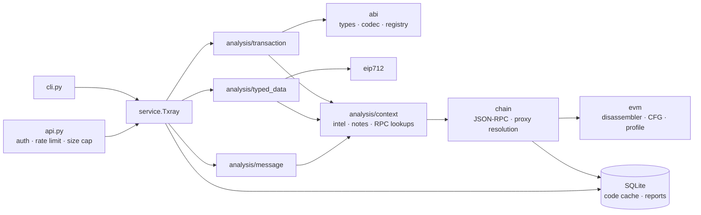

# txray

Pre-signing risk analysis for EVM transactions, EIP-712 signature requests and
`personal_sign` messages, backed by a static analyzer for contract bytecode.

txray takes exactly what a wallet is about to sign, decodes it, inspects the contracts
involved on-chain and returns a verdict (`pass` / `warn` / `block`) with explained
findings. It runs as a CLI or as an authenticated HTTP API.

```
$ txray typed-data examples/seaport-zero-price-listing.json
BLOCK  score 100/100  (typed_data, report 148bc06209e34a8ca3d022a472583ac1)

  type    OrderComponents (seaport-order)
  digest  0x50897b3957ee616c5a48e916e4c6d84b465dc55182e7901fb48b96d3c3fcf00b

  [CRITICAL] INT001 Interaction with a denylisted address
             The message.consideration[0].recipient 0x7A3B…8C9d is denylisted (Example drainer (synthetic)).
  [CRITICAL] SIG030 Marketplace order gives assets away
             0x5B38…ddC4 offers 2 item(s) and receives nothing; consideration goes to 0x7A3B…8C9d.
```

## The problem

Most wallet-drain losses do not come from protocol bugs. They come from a user signing
something whose effect they could not see:

- **Off-chain signatures.** ERC-2612 `permit`, Permit2 `PermitBatch` and Seaport orders
  are plain EIP-712 messages. Signing one creates no transaction, costs no gas and leaves
  nothing in the wallet history, yet hands over tokens or NFTs. Drainer kits rely on this.
- **Approvals.** `approve(spender, 2**256-1)` or `setApprovalForAll(operator, true)` to an
  attacker-controlled account, often wrapped inside a `multicall`.
- **Address poisoning.** Attackers send dust from a vanity address matching the first and
  last characters of an address the victim uses, hoping it gets copy-pasted from history.
- **Blind signing.** `eth_sign` of a raw 32-byte hash, or Sign-In-with-Ethereum messages
  relayed from another domain.
- **Unknown contracts.** The target is unverified; nobody knows what the called function
  can do.

Wallet UIs show some of this, but inconsistently, and rarely explain *why* a request is
dangerous. txray is a self-hostable engine that does, with rules that can be tested,
audited and extended.

## Features

| Area | What is implemented |
|---|---|
| Transactions | ABI decoding of ERC-20/721/1155, Permit2 and Multicall/Multicall3 calls (batches decoded recursively, 3 levels); unlimited/EOA allowances, operator approvals, Permit2 allowance lifetime, tokens sent to the token contract, selectors missing from the target's dispatcher, drainer-style payable functions, functions that can reach `SELFDESTRUCT` |
| EIP-712 | Full `encodeType`/`hashStruct` implementation (verified against the EIP-712 spec vectors), signing digest output; analysis of ERC-2612 and DAI permits, Permit2 `PermitSingle`/`PermitBatch`/`PermitTransferFrom` (+witness), Seaport `OrderComponents` and `BulkOrder`; chain-id mismatch, protocol impersonation, verifying contract without code |
| Messages | `eth_sign` raw hashes, binary `personal_sign` payloads, EIP-4361 (SIWE) parsing with domain binding, address, chain and validity-window checks |
| Bytecode | Disassembler, CFG built by abstract interpretation (jump targets resolved through the stack, internal-call returns kept precise per entry point), dispatcher extraction, per-function reachability of `SELFDESTRUCT`/`DELEGATECALL`/`CREATE2`, EIP-1167/EIP-1967/beacon/ZeppelinOS proxy detection and on-chain resolution, Solidity metadata (CBOR) parsing, privileged-function detection |
| Intel | Denylist, address book with look-alike (poisoning) detection, verified list of canonical protocol deployments (Permit2, Seaport 1.5/1.6, OpenSea conduit, major routers) |
| Service | FastAPI server with API-key auth (hashed keys, constant-time comparison), token-bucket rate limiting, streamed body-size limit, SQLite report store and RPC code cache, structured JSON logs; CLI with text/JSON output and CI-friendly exit codes |

The complete rule catalog with rationales is in [docs/RULES.md](docs/RULES.md) (generated from
the code; a test fails if it drifts).

## Architecture



- **`evm/`** is self-contained: it turns runtime bytecode into a `BytecodeProfile`
  (selectors, per-function reachable opcodes, proxy layout, findings). Profiles are
  memoized by code content.
- **`analysis/`** holds one analyzer per request type. They share an `AnalysisContext`
  that resolves contracts lazily through the configured RPC, applies denylist/look-alike
  checks once per address, and collects notes when a check could not run (offline, RPC
  failure) so a missing check is never silently reported as safe.
- **`rules.py`** is the single catalog of rule IDs, titles and default severities; analyzers
  can only emit findings through it.
- The CLI and the API both call `service.Txray`, so they produce identical reports.

Design decisions and their trade-offs are detailed in
[docs/ARCHITECTURE.md](docs/ARCHITECTURE.md).

### Technical choices

- **Python 3.11+.** The analysis is I/O-light and CPU-light (a 23 KB contract is profiled in
  well under 100 ms), and Python keeps the rules readable for security reviewers.
- **No web3 library.** ABI decoding, EIP-712 hashing, EIP-55 checksums, CBOR metadata and the
  JSON-RPC client are implemented directly: the decoder must be strict with hostile input
  (bounds, padding, allocation limits), and the dependency surface of a security tool
  matters. Runtime dependencies: FastAPI, uvicorn, httpx, pydantic, pycryptodome (Keccak).
- **SQLite** for the report store and code cache: single container, no external service.
- **RPC endpoints are server-side configuration only.** API clients choose a chain id, never
  a URL, which rules out SSRF through the API.

## Installation

Requires Python 3.11 or newer.

```bash
git clone https://github.com/zabubu/txray.git
cd txray
python3 -m venv .venv
.venv/bin/pip install -e ".[dev]"     # or: make install
.venv/bin/txray --version
```

### Docker

```bash
txray keygen                                   # prints an API key and its SHA-256
export TXRAY_API_KEY_HASHES=<sha256 from keygen>
docker compose up --build                      # API on http://127.0.0.1:8080
```

The image runs as an unprivileged user; the compose file adds a read-only root
filesystem, dropped capabilities and `no-new-privileges`.

## Configuration

Settings come from an optional TOML file (`--config` or `TXRAY_CONFIG`, see
[config/txray.example.toml](config/txray.example.toml)), overridden by environment variables:

| Variable | Meaning | Default |
|---|---|---|
| `TXRAY_RPC_<chainId>` | JSON-RPC endpoint for a chain, e.g. `TXRAY_RPC_1` | none (offline) |
| `TXRAY_DB` | SQLite path for reports and the code cache | none (no persistence) |
| `TXRAY_API_KEY_HASHES` | comma-separated SHA-256 digests of API keys | none |
| `TXRAY_ALLOW_ANONYMOUS` | serve without API keys (local development) | `false` |
| `TXRAY_RATE_LIMIT` | requests per minute per key (or IP); `0` disables | `120` |
| `TXRAY_MAX_BODY_BYTES` | request body cap | `262144` |
| `TXRAY_DENYLIST` | file of `address[,label]` lines | none |
| `TXRAY_ADDRESS_BOOK` | trusted addresses, used for poisoning detection | none |
| `TXRAY_LOG_LEVEL` / `TXRAY_LOG_JSON` | server logging | `INFO` / `false` |

The server refuses to start without at least one API key unless anonymous mode is
explicitly enabled. Analysis commands of the CLI log at `WARNING` unless `--log-level`
is given, so stdout only carries the report.

## Usage

The examples below use the sample lists shipped in `config/`:

```bash
export TXRAY_DENYLIST=config/denylist.example.txt
export TXRAY_ADDRESS_BOOK=config/address_book.example.txt
export TXRAY_RPC_1=https://ethereum-rpc.publicnode.com   # omit and use --offline to skip RPC
```

### Signature requests

```bash
txray typed-data examples/permit2-batch-sweep.json
txray typed-data examples/erc2612-unlimited-permit.json --from 0x5B38Da6a701c568545dCfcB03FcB875f56beddC4
txray message --file examples/siwe-login.txt --origin https://app-example-login.net
txray message --method eth_sign --hex 0x$(printf 'ab%.0s' {1..32})
```

### Transactions

An unlimited USDC approval to an EOA, hidden inside a Multicall3 `aggregate3`:

```
$ txray tx --to 0xcA11bde05977b3631167028862bE2a173976CA11 --data 0x82ad56cb…
BLOCK  score 100/100  (transaction, report 72d6ac63ecca41c593af510688a0a1e5)

  call    aggregate3((address,bool,bytes)[]) on 0xcA11bde05977b3631167028862bE2a173976CA11
          -> approve(address,uint256) on 0xA0b86991c6218b36c1d19D4a2e9Eb0cE3606eB48

  [CRITICAL] TX002 Allowance granted to an account without code
             Allowance on 0xA0b8…eB48 granted to 0xABaB…ABaB, an account without code.
  [  MEDIUM] TX001 Unlimited token allowance
             Unlimited allowance for 0xABaB…ABaB on 0xA0b8…eB48.
  [    INFO] TX011 Batched calls
             aggregate3((address,bool,bytes)[]) wraps 1 call(s).
```

Address poisoning (the recipient imitates an address-book entry):

```bash
txray tx --to 0xA0b86991c6218b36c1d19D4a2e9Eb0cE3606eB48 \
  --data "$(python3 -c 'import json;print(json.load(open("examples/requests/poisoned-transfer.json"))["data"])')"
# BLOCK ... INT002 Address resembles a trusted address (address poisoning)
```

### Bytecode

```
$ txray bytecode --address 0x000000000022D473030F116dDEE9F6B43aC78BA3
PASS  score 0/100  (bytecode, report d0708f1cfb7f45aeb430f9886081a624)

  code    9152 bytes, 0xc67d1657868aa5146eaf24fb879fb1fdec3d2d493b3683a61c9c2f4fb2851131
  built   solc 0.8.17
  funcs   15 selectors, CFG complete: True
          0xfe8ec1a7 permitWitnessTransferFrom(((address,uint256)[],uint256,uint256),…)
          0xcc53287f lockdown((address,address)[])
          0x87517c45 approve(address,address,uint160,uint48)
          …
```

Proxies are followed: `txray bytecode --address 0xA0b8…eB48` (USDC) reports the
ZeppelinOS proxy and profiles its implementation (blacklist, mint, pause capabilities).

```bash
txray disasm --file tests/fixtures/bytecode/weth9.hex --blocks   # CFG with reachability
txray rules                                                       # rule catalog
```

### CLI options

- `--json` prints the full report; `--fail-on {low,medium,high,critical}` exits with
  status 3 when a finding reaches that severity (useful in scripts and CI).
- `--offline` disables RPC lookups; checks that need chain state are listed in the
  report notes.
- `txray report <id>` prints a stored report (requires `TXRAY_DB`).

### HTTP API

```bash
txray serve --host 127.0.0.1 --port 8080
curl -s localhost:8080/v1/analyze/typed-data \
  -H "x-api-key: $TXRAY_API_KEY" -H 'content-type: application/json' \
  -d @examples/requests/permit2-batch-sweep.json
```

| Method | Path | Body |
|---|---|---|
| `GET` | `/health` | public |
| `GET` | `/v1/rules` | rule catalog |
| `POST` | `/v1/analyze/transaction` | `{from?, to?, data, value, context}` |
| `POST` | `/v1/analyze/typed-data` | `{from?, typed_data, context}` |
| `POST` | `/v1/analyze/message` | `{from?, method, message, context}` |
| `POST` | `/v1/analyze/bytecode` | `{code}` or `{address, context}` |
| `GET` | `/v1/reports`, `/v1/reports/{id}` | stored reports |

`context` is `{chain_id?, origin?, offline?}`. OpenAPI docs are served at `/docs`.
Errors use `{"error": {"code", "message"}}` with status 401, 413, 422, 429 or 502.

A report looks like:

```json
{
  "id": "…", "kind": "transaction", "verdict": "block", "score": 80,
  "max_severity": "critical", "chain_id": 1,
  "findings": [{"rule_id": "INT002", "severity": "critical", "title": "…", "detail": "…", "evidence": {…}}],
  "decoded": {"call": {"function": "transfer(address,uint256)", "args": {…}}},
  "notes": ["…"]
}
```

`verdict` is `block` if any finding is critical, `warn` for medium or high, `pass`
otherwise. `score` is a capped sum of severity weights, meant for sorting, not as a
probability.

## Tests

```bash
make check     # ruff, ruff format --check, mypy --strict, pytest
make cov       # with coverage
make live      # opt-in tests against a real mainnet RPC
```

Current state: **191 tests passing, 90 % line+branch coverage**, plus 2 live tests
(skipped by default). `mypy --strict` and ruff report no issues.

- Unit tests cover the ABI codec (including hostile payloads: dirty padding, out-of-bound
  offsets, allocation bombs, invalid UTF-8), EIP-55 and EIP-712 reference vectors, the
  CFG (internal-call return resolution, loops, dynamic jumps), and each rule.
- Bytecode tests run on **real mainnet runtime code** stored in `tests/fixtures/bytecode`
  (WETH9, Permit2, Multicall3, USDC proxy and implementation), plus small contracts written
  with the built-in assembler (`txray.evm.disassembler.assemble`).
- Integration tests drive the FastAPI app (auth, rate limiting, body limits including
  chunked bodies without `Content-Length`, persistence) and the CLI entry point.
- CI runs the suite on Python 3.11, 3.12 and 3.13 and smoke-tests the Docker image.

## Limitations

- **Heuristics, not proofs.** Rules flag known attack shapes. A novel drainer pattern can
  pass; a legitimate but unusual request can be flagged. Treat `pass` as "nothing known
  matched", not as "safe".
- **No transaction simulation.** txray does not execute the transaction against a fork,
  so it does not compute balance changes; effects of unknown functions are inferred only
  from static reachability.
- **Static analysis bounds.** Selector extraction recognizes solc's linear dispatcher
  (`PUSH4 … EQ … JUMPI`); Vyper jump-table dispatch and hand-written assembly are not
  parsed, in which case no selector-based finding is produced. Jump resolution handles
  compiler-generated control flow; code with computed jump targets is reported as such
  (`BC008`) and opcode presence is used as a fallback.
  Reachability is not path-feasibility: a `SELFDESTRUCT` guarded by an owner check is still
  reported as reachable.
- **Intel is local.** The denylist and address book are whatever you configure; no threat
  feed is bundled. The known-contract list is short and mostly mainnet-specific (CREATE2
  deployments such as Permit2 and Seaport are recognized on every chain).
- **Proxy resolution** follows one level (EIP-1167, EIP-1967 implementation/beacon,
  ZeppelinOS, EIP-1822). Diamond proxies (EIP-2535) are not resolved.
- Prices are unknown, so a Seaport listing priced far below market but above zero is not
  flagged; only orders where the offerer receives nothing are.

## Roadmap

1. Fork simulation through `eth_call` with state overrides / `debug_traceCall` to report
   asset deltas alongside static findings.
2. EIP-2535 diamond facet resolution and Safe (Gnosis) transaction decoding.
3. Uniswap Universal Router command decoding (`execute(bytes,bytes[])`).
4. Pluggable intel sources (signed denylist feeds) with per-source provenance in findings.
5. A small browser-extension client that calls the API before forwarding requests to the
   wallet.

## Contributing and security

See [CONTRIBUTING.md](CONTRIBUTING.md) and [SECURITY.md](SECURITY.md).

## License

MIT, see [LICENSE](LICENSE).
